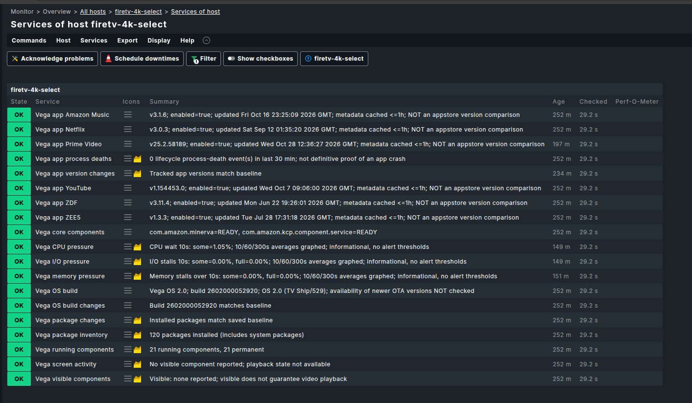
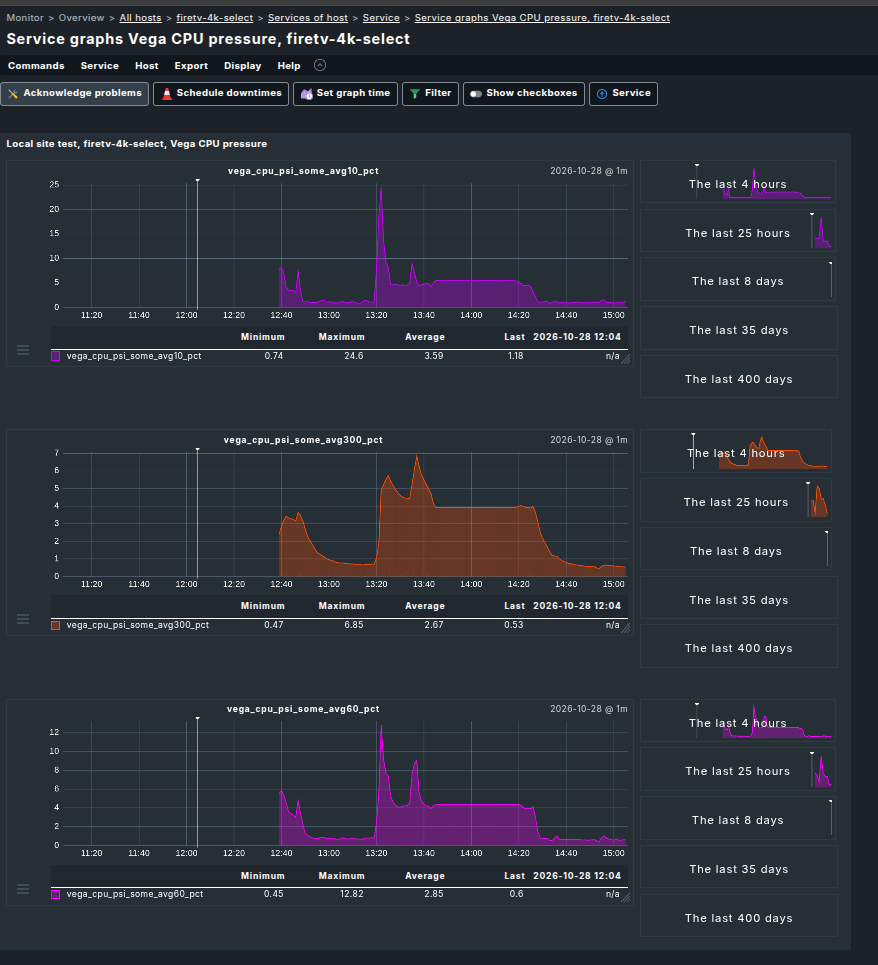
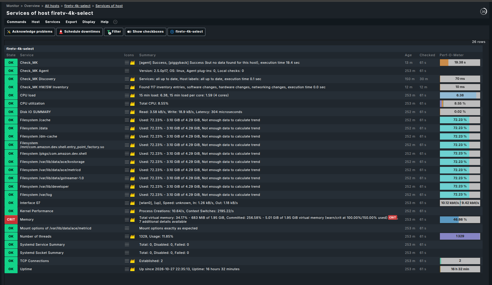

# Fire TV Vega OS Monitoring for Checkmk

**Vega CMK** is an experimental Checkmk extension for monitoring a **Vega OS** Amazon Fire TV through the **Vega Device Adapter (VDA)**. It combines Linux agent sections with Vega-specific local checks and an authenticated, manual screenshot viewer.

[Installation and prerequisites](docs/SETUP.md) · [Monitoring and configuration](docs/MONITORING.md) · [Known limitations](docs/KNOWN_ISSUES.md) · [Security](docs/SECURITY.md) · [Changelog](CHANGELOG.md)

**First public release:** `0.0.1` · **License:** GPL-2.0-only · **Checkmk minimum:** 2.5.0 · **Tested environment:** Checkmk 2.5.0p17 and Fire TV Stick 4K Select on Vega OS 2.0. No maximum Checkmk version is declared; future compatibility is **not** guaranteed.

> **Scope:** Lab/QA use, **one configured Fire TV per Checkmk site**. The **Checkmk site and Vega SDK/VDA must run on the same Linux machine** for this release; the Fire TV itself can be elsewhere on a reachable trusted network. This is **not** an Android ADB integration, a production fleet manager, or a playback-state detector. Developer Mode and VDA grant significant device access; use on trusted networks only.

## Features

- Native Linux monitoring sections for CPU, load, memory, network, filesystem and related checks, transported using VDA.
- Vega package inventory, firmware and selected app versions, baseline-based change detection, process-death diagnostics, and foreground component/activity observations.
- Informational **Vega memory, CPU and I/O pressure** (Linux PSI) with graphable 10/60/300-second metrics and no new warning/critical thresholds.
- Protected, on-demand screenshots using a Checkmk-authenticated page, POST/CSRF safeguards, private PNG storage and a cooldown. No automatic capture or playback control.
- Site-local JSON configuration of VDA path, device address, monitored application IDs and optional PSI switches. No IP, SDK binary or sensitive site state is bundled.

The standard Checkmk **Memory** and filesystem checks are **not modified**. Repeated mounts and committed-memory alerts are explained under [Monitoring](docs/MONITORING.md); any tuning is optional.

## Screenshots — real device monitoring

Screenshots from the **Fire TV Stick 4K Select** running Vega OS 2.0, monitored by Checkmk 2.5.0p17. These show actual lab observations rather than mockups. Service states, versions and performance measurements vary by device and time.

### Vega-specific services

Application versions (including Prime Video), baseline/change checks, component activity and the three informational Linux PSI services:



### Vega CPU pressure — historical graphs

Linux PSI `some` CPU scheduling pressure, including 10-, 60- and 300-second moving averages. These measurements are **not CPU utilization percentages**:



<details>
<summary><strong>Show the standard Linux services (CPU, storage, memory, network and uptime)</strong></summary>

The same Vega OS device also provides regular Checkmk Linux metrics. The standard **Memory** service displays a committed-memory **CRIT** based on Linux overcommit accounting; this is independent of the informational Vega memory-pressure check and is intentionally left unchanged. See [monitoring guidance](docs/MONITORING.md).



</details>

## Deployment topology and network requirements

**This release provides a local data-source program, not a remote collector.** The Checkmk **site process**, its `firetv_agent` wrapper, the **Vega SDK/VDA executable**, site-local `firetv_vega.json`, and the screenshot helper must reside on the **same Linux host**. The Fire TV may be in another location **only if VDA can reach its developer TCP endpoint over a trusted network or VPN**. No Checkmk agent runs natively on the Fire TV in the conventional TCP 6556 model; our wrapper invokes an agent through VDA.

| Deployment | v0.0.1 status |
| --- | --- |
| Checkmk site + VDA on one Linux host, Fire TV reachable over VDA TCP (usually 5555) | **Supported; tested on a local network** |
| Same site/VDA host, Fire TV reached across a routed private network or VPN | **Architecturally compatible, but not independently tested**; verify TCP reachability and device authorization |
| Central Checkmk UI with a **remote Checkmk monitoring site** installed alongside VDA | **Potentially viable via Checkmk distributed monitoring, untested here**; install MKP and configure the data source on the site that runs VDA |
| Checkmk site at A; an ordinary Linux **Checkmk agent** (TCP 6556) + VDA on host B | **Not implemented**; a normal agent connection does not run this MKP's local data-source program on B |
| Checkmk site at A; SSH into a VDA host B | **Not implemented**; no remote SSH wrapper or secure remote screenshot transfer is shipped |
| Multiple Fire TVs from one Checkmk site configuration | **Not supported**; current private JSON selects a single device |

The current **authenticated screenshot viewer also runs on the Checkmk site host**. It cannot contact a different VDA machine via an ordinary agent connection or SSH without additional code. **Do not expose the local VDA server port (typically 5037), device developer port (typically 5555), screenshots, or the Checkmk site to the public internet.** See [Deployment details](docs/SETUP.md#supported-deployment-models-for-v001) and [Security](docs/SECURITY.md).

Remote collection via a Linux agent/piggyback, an SSH transport, remote screenshots and multi-device support are **future design options**, not features of this release. This limitation does not block publication as a clearly scoped experimental package.

## Quick start

1. Verify the [supported deployment layout](docs/SETUP.md#supported-deployment-models-for-v001), then follow [prerequisites and installation](docs/SETUP.md): Checkmk 2.5+, **Vega SDK/VDA on that same Checkmk site host**, authenticated Vega Developer Mode, VDA TCP connection, and a readable local Linux Checkmk agent file.
2. Install the MKP from `dist/firetv_vega_vda-0.0.1.mkp` or the [GitHub Releases page](https://github.com/ghatak-x/vega-cmk/releases/tag/v0.0.1) on a **test site**:

   ```bash
   mkp inspect /path/to/firetv_vega_vda-0.0.1.mkp
   mkp add /path/to/firetv_vega_vda-0.0.1.mkp
   mkp enable firetv_vega_vda 0.0.1
   ```

3. Copy `examples/firetv_vega.json.example` to `~/etc/firetv_vega.json`, set the exact address and your SDK VDA executable path, then `chmod 600 ~/etc/firetv_vega.json`.
4. Verify `python3 ~/local/bin/firetv_vega_extras.py --diagnose` and `--list-components` succeed.
5. Create a Checkmk host and apply a host-specific **Individual program call instead of agent access** rule (this is **not a registered special agent**) with:

   ```text
   /usr/bin/python3 /omd/sites/<SITE>/local/bin/firetv_agent
   ```

6. Test `cmk -d <HOST>`, discover services and activate changes. Optional screenshot-viewer and first-baseline steps are in [Setup](docs/SETUP.md).

**Do not run the old standalone wrapper and this package's `firetv_agent` concurrently.** Keep the original working Checkmk site unchanged until the test site is verified.

## Repository layout

```text
vega-cmk/
├── README.md, CHANGELOG.md, LICENSE, manifest.json
├── docs/              # SETUP, MONITORING, KNOWN_ISSUES, SECURITY, images/
├── examples/          # Safe site-local JSON template (TEST-NET address)
├── src/bin/           # VDA bridge, Linux agent wrapper and local checks
├── src/web/           # Screenshot page and camera icon
├── tests/             # Offline tests with simulated VDA
├── build_mkp.py       # Standard Checkmk MKP builder
└── dist/              # Built release MKP and SHA256SUMS
```

The MKP automatically embeds a copy of the public docs and these example images under `~/local/bin/firetv_docs/` when built. That installed copy is **generated in memory** by the builder, not duplicated under source control.

## Build and test

```bash
python3 build_mkp.py
python3 -m unittest discover -s tests -v
cd dist && sha256sum -c SHA256SUMS
```

The repository's `manifest.json` is the human-readable **build metadata**, while Checkmk MKPs contain their own `info`/`info.json` manifests inside the tar archive. The `dist/` directory contains the release asset; upload that `.mkp` to GitHub Releases for `v0.0.1`.

## Limitations and support

The developer shell does not provide a full host process list (`<<<ps_lnx>>>` empty on the tested retail device); Vega component checks do not imply actual playback. Active Prime Video playback may block screenshot capture, whereas pausing can permit it. The Vega Media Controls endpoint probe produced a native access error, so video title/play/pause tracking is not implemented. See [Known Issues](docs/KNOWN_ISSUES.md).

**Security:** A screenshot can reveal personal on-screen content. Review the [security guide](docs/SECURITY.md) before enabling Developer Mode, using a shared Checkmk site, or publishing logs.

